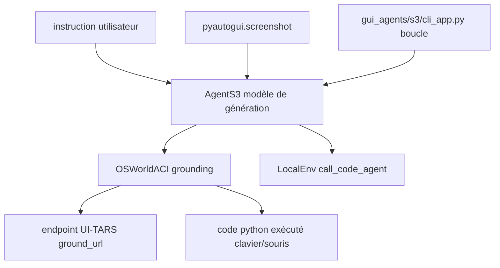

# simular-ai/Agent-S

> Agent that drives the mouse, keyboard and screen of a real workstation, for research and office automation.

## The problem
Automating an application without an API requires writing one script per application, fragile at the slightest interface change.
"Computer use" agent benchmarks remained far from human level, hence unusable in practice.

## What it actually does
Takes a natural-language instruction, reads a screenshot, then clicks, types and scrolls until the result is reached.
Two distinct models: a generation model (gpt-5 recommended) and a *grounding* model that translates an intent into coordinates (UI-TARS-1.5-7B recommended).
An optional reflection agent assists the worker agent; `--enable_local_env` adds execution of local Python and Bash.
Runs on macOS, Windows and Linux, as a CLI (`agent_s`) or through the `gui_agents` SDK (`AgentS3`, `OSWorldACI`).

## How it is wired


## Trying it
```bash
pip install gui-agents
pip install -e .
brew install tesseract
export OPENAI_API_KEY=<YOUR_API_KEY>
agent_s --provider openai --model gpt-5-2025-08-07 --ground_provider huggingface --ground_url http://localhost:8080 --ground_model ui-tars-1.5-7b --grounding_width 1920 --grounding_height 1080
```

## Cost and gotchas
Two bills: the main model (OpenAI, Anthropic…) and the grounding endpoint, to host or rent (Hugging Face Inference Endpoints).
A single screen is required. `--enable_local_env` runs arbitrary Python and Bash with your privileges: reserve it for a trusted environment.

## What it is not
Not the product: the README directs to Sai, Simular's hosted agent, for production use.
Not plug-and-play: without a grounding model served somewhere, nothing works, and `grounding_width/height` must match the model.
Not safe by construction — the README says so: the agent runs Python code to control the machine.

## Alternatives
- GTA1 w/ GPT-5: prior state of the art cited in the OSWorld results.
- Sai: the same vendor's hosted version, if you want a product and not a research framework.

## For you
Worth following for tasks without an API; the double model + grounding cost makes it expensive for daily use.
