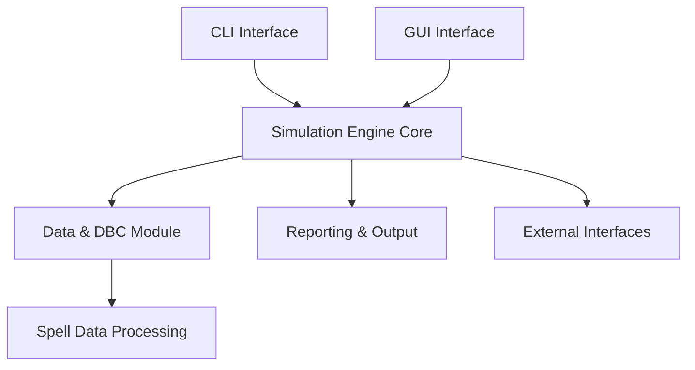

# simulationcraft/simc

> Event-driven C++ simulator that estimates the damage per second of World of Warcraft characters.

## The problem
Analytical calculators become inaccurate with class synergies and random proc effects.

## What it actually does
Simulates fights in C++ through an event manager, action priority lists and game data (DBC). Produces reports and charts, including stat weights for choosing gear. Two executables: `simc` (command line, recommended) and a poorly maintained Qt interface. Can download characters from the Armory.

## How it is wired

## Trying it
No command in the README: download the Windows package, or build it yourself on Linux (no Linux release is shipped).

## Cost and gotchas
Free, GPL-3.0 license. No Linux binary; the graphical interface is poorly maintained. Not to be confused with SimCraft, a racing simulator.

## What it is not
Not a general-purpose simulation tool: it is specific to World of Warcraft.

## Alternatives
No alternative named in the README.

## For you
Ignore: a video game simulator, unrelated to your data, AI or MLOps work.
