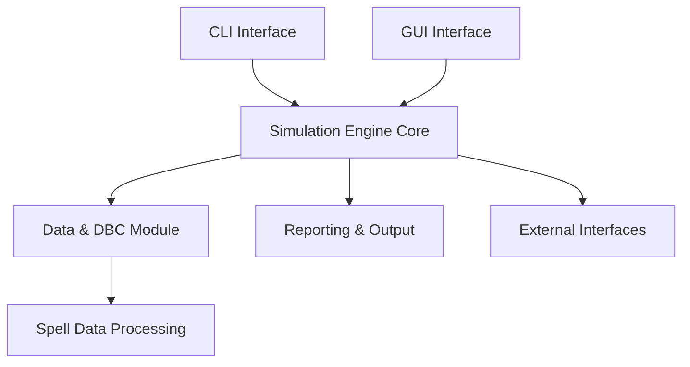

# simulationcraft/simc

> Simulateur événementiel en C++ qui estime les dégâts par seconde des personnages de World of Warcraft.

## Le problème
Les calculateurs analytiques deviennent inexacts avec les synergies de classes et les effets aléatoires de proc.

## Ce que ça fait vraiment
Simule des combats en C++ via un gestionnaire d'événements, des listes de priorité d'actions et des données de jeu (DBC). Produit rapports et graphiques, y compris les poids de statistiques pour choisir l'équipement. Deux exécutables : `simc` (ligne de commande, recommandé) et une interface Qt peu maintenue. Peut télécharger des personnages depuis l'Armory.

## Comment c'est branché

## Essayer
Aucune commande dans le README : télécharger le paquet Windows, ou compiler soi-même sous Linux (pas de version Linux livrée).

## Coût et pièges
Gratuit, licence GPL-3.0. Pas de binaire Linux ; l'interface graphique est peu maintenue. Se distingue de SimCraft, simulateur de courses.

## Ce que ce n'est pas
Pas un outil général de simulation : il est spécifique à World of Warcraft.

## Alternatives
Aucune alternative nommée dans le README.

## Pour toi
À ignorer : simulateur de jeu vidéo, sans rapport avec ton métier data, IA ou MLOps.

