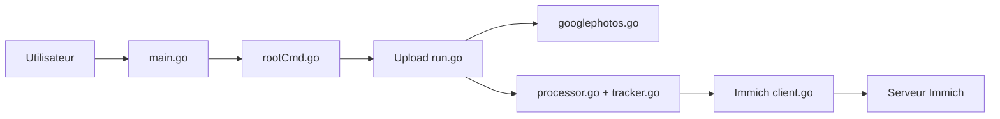

# simulot/immich-go

> Command-line tool for uploading large photo collections to a self-hosted Immich server.

## The problem
Migrating tens of thousands of photos (Google Photos Takeout, iCloud, folders) to Immich by hand loses albums, dates and metadata.

## What it actually does
Subcommands `upload from-folder`, `from-google-photos`, `from-immich`, `from-picasa`, `from-icloud`, plus `archive from-immich`. Detects duplicates, stacks bursts and RAW+JPEG pairs, creates albums and tags, ignores junk files (`.DS_Store`, `@eaDir/`…). Can pause Immich's background jobs during the upload.

## How it is wired


## Trying it
```bash
immich-go upload from-folder --server=http://your-ip:2283 --api-key=your-api-key /path/to/your/photos
immich-go upload from-google-photos --server=http://your-ip:2283 --api-key=your-api-key /path/to/takeout-*.zip
immich-go archive from-immich --from-server=http://your-ip:2283 --from-api-key=your-api-key --write-to-folder=/path/to/archive
```

## Cost and gotchas
Free. You need an Immich server and an API key with the right permissions. The README warns: early version, lightly tested, keep a copy of your files. The removal of `ReplaceAsset` (v0.32.0) is a breaking change.

## What it is not
Not a photo manager: it is an importer for Immich only. Nothing to do with image recognition.

## Alternatives
No alternative named in the README.

## For you
Ignore: only really useful if you are migrating a photo library to Immich, unrelated to data/AI work.
