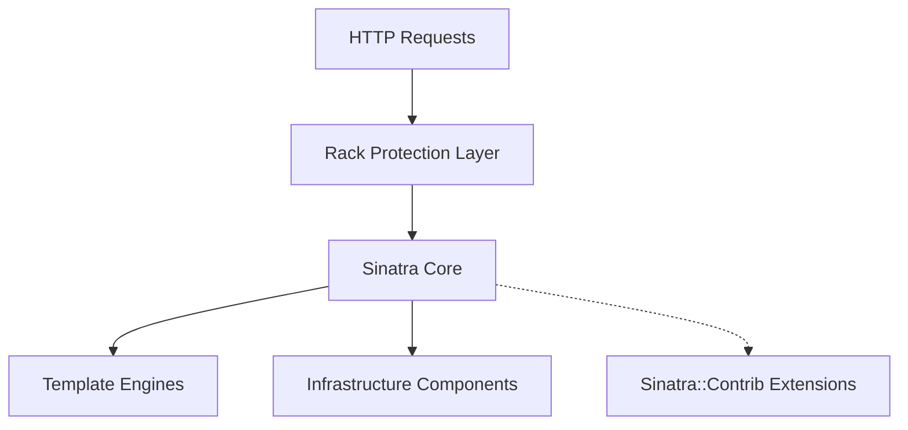

# sinatra/sinatra

> Ruby micro-framework for writing a web application in a few lines, aimed at Ruby developers.

## The problem
Setting up a small web service in Ruby with a full framework takes many files and much configuration for a minimal need.

## What it actually does
A DSL where each route associates an HTTP method, a URL pattern and a block. It handles parameters, conditions, filters, signed-cookie sessions, static files, streaming and many template engines (ERB, Haml, Slim, Markdown…). Modified code is not reloaded without a restart or a reloading tool.

## How it is wired


## Trying it
```bash
gem install sinatra rackup puma
ruby myapp.rb
# puis http://localhost:4567
```

## Cost and gotchas
Free. Requires Ruby and the gems (no value in the list covers Ruby). The session secret is regenerated at every restart: set it via `SESSION_SECRET` if there are several instances.

## What it is not
Not a full-stack framework: no ORM and no imposed structure. Code reloading is not automatic.

## Alternatives
No alternative named in the README.

## For you
Ignore for a data/AI/MLOps profile: it is a Ruby web tool, unrelated to your Python stacks; only a Ruby API prototype would justify a look.
