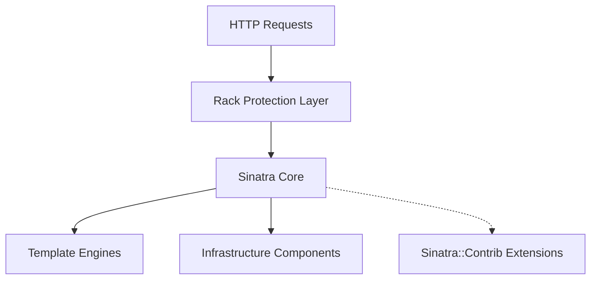

# sinatra/sinatra

> Micro-framework Ruby pour écrire une application web en quelques lignes, destiné aux développeurs Ruby.

## Le problème
Monter un petit service web en Ruby avec un framework complet demande beaucoup de fichiers et de configuration pour un besoin minime.

## Ce que ça fait vraiment
Un DSL où chaque route associe une méthode HTTP, un motif d'URL et un bloc. Il gère paramètres, conditions, filtres, sessions par cookie signé, fichiers statiques, streaming et de nombreux moteurs de templates (ERB, Haml, Slim, Markdown…). Le code modifié n'est pas rechargé sans redémarrage ou outil de rechargement.

## Comment c'est branché


## Essayer
```bash
gem install sinatra rackup puma
ruby myapp.rb
# puis http://localhost:4567
```

## Coût et pièges
Gratuit. Il faut Ruby et les gems (aucune valeur de la liste ne couvre Ruby). Le secret de session est régénéré à chaque redémarrage : à fixer via `SESSION_SECRET` si plusieurs instances.

## Ce que ce n'est pas
Pas un framework full-stack : pas d'ORM ni de structure imposée. Le rechargement du code n'est pas automatique.

## Alternatives
Aucune alternative nommée dans le README.

## Pour toi
À ignorer pour un profil data/IA/MLOps : c'est un outil de web Ruby, sans lien avec tes piles Python ; seul un prototype d'API en Ruby justifierait de le regarder.

