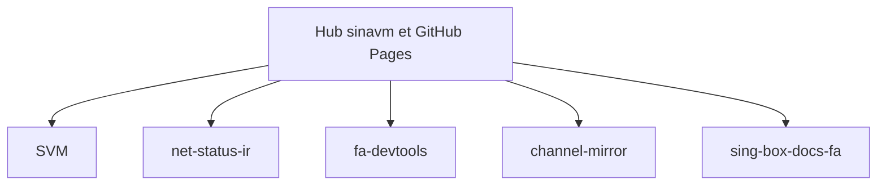

# sinavm/sinavm

> Profile of an Iranian developer who publishes free tools for access to information under network restrictions.

## The problem
When the Internet is cut or restricted in Iran, accessing documents and tools becomes difficult.

## What it actually does
- Profile page in Persian listing projects: SVM (collection and conversion of subscriptions), net-status-ir, fa-devtools, channel-mirror.
- Other entries: php-actions-kit, fa-readme, sing-box-docs-fa, ir-oss-list, melishekan.
- Updates via Telegram and GitHub; the README provided details no project.

## How it is wired
Simplified diagram based on the fiche, no diagram provided.


## Trying it
```bash
# Aucune commande documentée.
```

## Cost and gotchas
Free. Insufficient material: the README is a simple profile, the license is present but unidentified, and the projects cited are in other repositories.

## What it is not
Not a software tool or a library: a presentation page. The content is in Persian.

## Alternatives
No alternative named in the README.

## For you
Ignore: a simple profile page with no technical content usable for a data, AI or MLOps profile.
