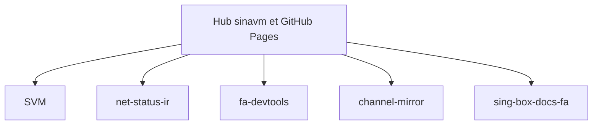

# sinavm/sinavm

> Profil d'un développeur iranien qui publie des outils libres pour l'accès à l'information sous restrictions réseau.

## Le problème
En cas de coupure ou de restriction d'Internet en Iran, accéder à des documents et des outils devient difficile.

## Ce que ça fait vraiment
- Page de profil en persan listant des projets : SVM (collecte et conversion d'abonnements), net-status-ir, fa-devtools, channel-mirror.
- Autres entrées : php-actions-kit, fa-readme, sing-box-docs-fa, ir-oss-list, melishekan.
- Mises à jour par Telegram et GitHub ; le README fourni ne détaille aucun projet.

## Comment c'est branché
Schéma simplifié d'après la fiche, sans diagramme fourni.


## Essayer
```bash
# Aucune commande documentée.
```

## Coût et pièges
Gratuit. Matière insuffisante : le README est un simple profil, la licence est présente mais non identifiée, et les projets cités sont dans d'autres dépôts.

## Ce que ce n'est pas
Pas un outil logiciel ni une bibliothèque : une page de présentation. Le contenu est en persan.

## Alternatives
Aucune alternative nommée dans le README.

## Pour toi
À ignorer : simple page de profil sans contenu technique exploitable pour un profil data, IA ou MLOps.

