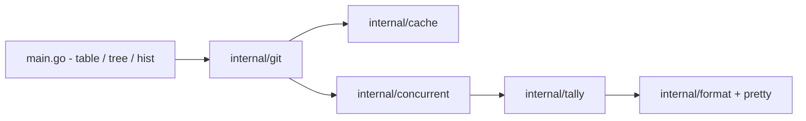

# sinclairtarget/git-who

> Command-line tool that shows who wrote what in a Git folder or subsystem.

## The problem
`git blame` only answers line by line; you do not know who really knows an entire module.

## What it actually does
Three subcommands: `table` (contributions per author), `tree` (file tree annotated with the main author), `hist` (timeline by year or month). Filters: path, branch, revision range, `--author`, `--since`. Metrics: commits, files, lines. It respects `.mailmap` and `.git-blame-ignore-revs`, and caches per repository under `XDG_CACHE_HOME`. Written in Go, it walks the history in parallel.

## How it is wired


## Trying it
```bash
brew install git-who
go install github.com/sinclairtarget/git-who@latest
git who
git who tree Parser/
git who hist v3.12.0..
```

## Cost and gotchas
Free. The cache can be disabled with `GIT_WHO_DISABLE_CACHE=1`. Merge commits are not counted by default; a renamed file counts twice.

## What it is not
Not a replacement for `git blame`: it measures who made the most changes, not who wrote each line. It measures activity, not quality.

## Alternatives
`git blame` (named in the README) for line-by-line attribution.

## For you
To adopt: a lightweight, free tool to spot the go-to people for a module before a handover or a review, including on your MLOps repositories.
