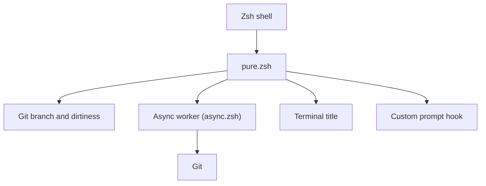

# sindresorhus/pure

> Minimal and fast ZSH prompt, with Git status computed asynchronously.

## The problem
Heavy prompts are slow and cluttered.

## What it actually does
Displays the Git branch and dirty state, arrows for unpushed or unpulled commits (checked asynchronously), execution time above a threshold, and the path and hostname over SSH. The symbol turns red after an error. Configured through `zstyle` and `PURE_*` variables, with `prompt_pure_precustom` as the entry point.

## How it is wired


## Trying it
```sh
npm install --global pure-prompt
# .zshrc
autoload -U promptinit; promptinit
prompt pure
```

## Cost and gotchas
Free. Requires Git 2.15.2+ and ZSH 5.2+. Install with `npm` and not `yarn`. A UTF-8 character set is needed or the prompt gets corrupted.

## What it is not
It is not a plugin manager or a theme for Bash. No runtime code provided in the sampled architecture, only the `pure.zsh` entry.

## Alternatives
pure10k (Powerlevel10k config imitating Pure), pure-fish/pure for Fish, xcambar/purs for Rust.

## For you
Worth watching: lightweight and very mature if you use zsh, with no stake for your AI work.
