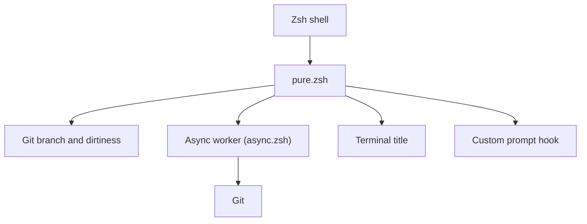

# sindresorhus/pure

> Invite de commande ZSH minimale et rapide, avec état Git calculé en asynchrone.

## Le problème
Les invites chargées sont lentes et encombrantes.

## Ce que ça fait vraiment
Affiche la branche Git et l'état sale, les flèches de commits non poussés ou non tirés (vérifiées en asynchrone), le temps d'exécution au-delà d'un seuil, le chemin et le nom d'hôte en SSH. Le symbole devient rouge après une erreur. Réglage par `zstyle` et variables `PURE_*`, point d'entrée `prompt_pure_precustom`.

## Comment c'est branché


## Essayer
```sh
npm install --global pure-prompt
# .zshrc
autoload -U promptinit; promptinit
prompt pure
```

## Coût et pièges
Gratuit. Exige Git 2.15.2+ et ZSH 5.2+. Installation par `npm` et non `yarn`. Un jeu de caractères UTF-8 est nécessaire sinon l'invite se corrompt.

## Ce que ce n'est pas
Ce n'est pas un gestionnaire de plugins ni un thème pour Bash. Aucun code d'exécution fourni dans l'architecture échantillonnée, seulement l'entrée `pure.zsh`.

## Alternatives
pure10k (config Powerlevel10k imitant Pure), pure-fish/pure pour Fish, xcambar/purs pour Rust.

## Pour toi
À surveiller : léger et très mûr si tu utilises zsh, sans aucun enjeu pour ton travail IA.

