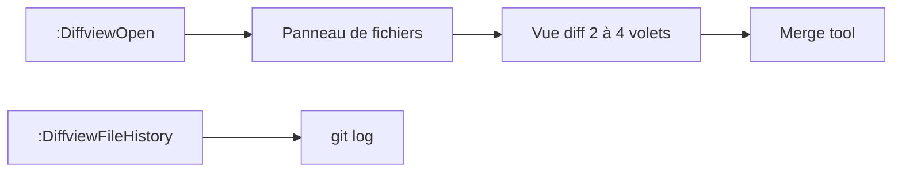

# sindrets/diffview.nvim

> Neovim plugin for browsing the Git diffs of all modified files in a single tab.

## The problem
Vim's diff mode cannot open all the files modified in a revision at once.

## What it actually does
`:DiffviewOpen` shows the changes of a revision, with hunk staging. `:DiffviewFileHistory` lists the commits of a path. A merge tool opens conflicts in a 3- or 4-pane view. Requirements: Git ≥ 2.31, Neovim ≥ 0.7 (Mercurial ≥ 5.4 optional).

## How it is wired


## Trying it
```vim
Plug 'sindrets/diffview.nvim'
:DiffviewOpen HEAD~2
:DiffviewFileHistory %
```

## Cost and gotchas
Free. Last push in August 2024: uncertain maintenance. License not identified by GitHub. Awesome-neovim recommends a maintained fork (dlyongemallo/diffview.nvim).

## What it is not
Not a full Git interface. You need to know `:h diff-mode`.

## Alternatives
dlyongemallo/diffview.nvim, a fork cited by another list in the batch; the README names no alternative.

## For you
Keep an eye on it: useful for reviewing diffs in Neovim, but the repo has been frozen since 2024: prefer a living fork.
