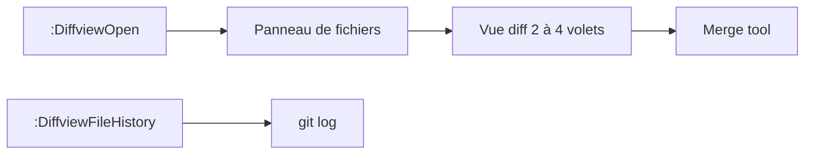

# sindrets/diffview.nvim

> Plugin Neovim pour parcourir les diffs Git de tous les fichiers modifiés dans un seul onglet.

## Le problème
Le mode diff de Vim ne permet pas d'ouvrir d'un coup tous les fichiers modifiés d'une révision.

## Ce que ça fait vraiment
`:DiffviewOpen` affiche les changements d'une révision, avec staging de hunks. `:DiffviewFileHistory` liste les commits d'un chemin. Un outil de merge ouvre les conflits en vue 3 ou 4 volets. Prérequis : Git ≥ 2.31, Neovim ≥ 0.7 (Mercurial ≥ 5.4 optionnel).

## Comment c'est branché


## Essayer
```vim
Plug 'sindrets/diffview.nvim'
:DiffviewOpen HEAD~2
:DiffviewFileHistory %
```

## Coût et pièges
Gratuit. Dernier push en août 2024 : maintenance incertaine. Licence non identifiée par GitHub. Awesome-neovim recommande un fork (dlyongemallo/diffview.nvim) maintenu.

## Ce que ce n'est pas
Pas une interface Git complète. Il faut connaître `:h diff-mode`.

## Alternatives
dlyongemallo/diffview.nvim, fork cité par une autre liste du lot ; le README ne nomme pas d'alternative.

## Pour toi
Surveiller : utile pour relire des diffs dans Neovim, mais dépôt gelé depuis 2024 : préfère un fork vivant.

