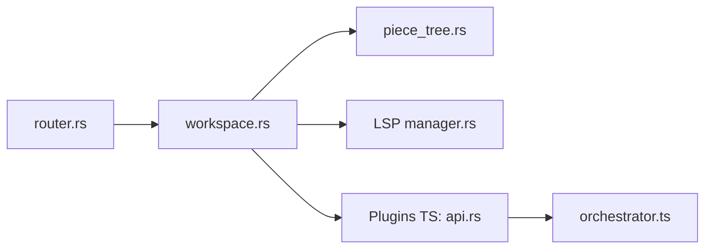

# sinelaw/fresh

> Terminal text editor with zero configuration, familiar shortcuts, mouse support and IDE features.

## The problem
Editing in a terminal without learning a modal language or configuring plugins.

## What it actually does
Editor written in Rust: command palette, multi-cursors, LSP, built-in terminals, TypeScript plugins (sandboxed QuickJS), large files with low memory use. An "Orchestrator" manages one workspace per git worktree and can launch coding agents (claude, codex, opencode, aider). A desktop version is available.

## How it is wired


## Trying it
```bash
curl -fsSL https://raw.githubusercontent.com/sinelaw/fresh/refs/heads/master/scripts/install.sh | sh
brew install fresh-editor
npm install -g @fresh-editor/fresh-editor
```

## Cost and gotchas
Anonymous telemetry (version, OS, terminal) and a daily update check; both can be disabled with `--no-upgrade-check` or `check_for_updates: false`. Installer via `curl | sh`.

## What it is not
Not a Neovim plugin nor a full IDE. Desktop builds are unsigned.

## Alternatives
No alternative named.

## For you
Keep an eye on it: interesting if you want to drive coding agents per worktree in the terminal; turn off telemetry before use.
