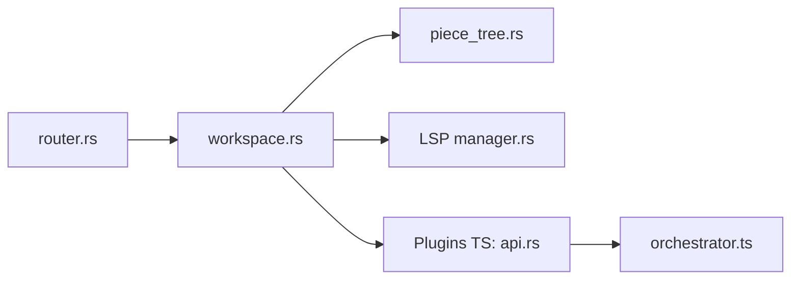

# sinelaw/fresh

> Éditeur de texte pour terminal, sans configuration, avec raccourcis familiers, souris et fonctions d'IDE.

## Le problème
Éditer en terminal sans apprendre un langage de modes ni configurer des plugins.

## Ce que ça fait vraiment
Éditeur en Rust : palette de commandes, multi-curseurs, LSP, terminaux intégrés, plugins TypeScript (QuickJS en bac à sable), gros fichiers à faible mémoire. Un « Orchestrator » gère un espace par git worktree et peut lancer des agents de code (claude, codex, opencode, aider). Version bureau disponible.

## Comment c'est branché


## Essayer
```bash
curl -fsSL https://raw.githubusercontent.com/sinelaw/fresh/refs/heads/master/scripts/install.sh | sh
brew install fresh-editor
npm install -g @fresh-editor/fresh-editor
```

## Coût et pièges
Télémétrie anonyme (version, OS, terminal) et vérification quotidienne des mises à jour ; désactivables par `--no-upgrade-check` ou `check_for_updates: false`. Installeur par `curl | sh`.

## Ce que ce n'est pas
Pas un plugin Neovim ni un IDE complet. Builds desktop non signés.

## Alternatives
Aucune alternative nommée.

## Pour toi
Surveiller : intéressant si tu veux piloter des agents de code par worktree dans le terminal ; coupe la télémétrie avant usage.

