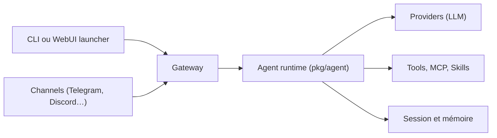

# sipeed/picoclaw

> Lightweight personal AI assistant in Go, able to run on Linux boards costing a few tens of dollars.

## The problem
Autonomous AI assistants consume a lot of memory and startup time, which rules out small embedded boards.

## What it actually does
A single Go binary that runs an agent: commands (agent, gateway, mcp, skills, cron), a gateway to 19 chat channels (Telegram, Discord, Slack, WhatsApp...), more than 30 LLM providers including local Ollama and vLLM. It handles MCP, SKILL.md skills, scheduled tasks and model routing depending on the request. A WebUI (launcher) configures provider and channel.

## How it is wired


## Trying it
```bash
picoclaw-launcher
picoclaw onboard
picoclaw agent -m "What is 2+2?"
picoclaw gateway
```

## Cost and gotchas
The provider's API key is at your expense, except with a local model (Ollama, vLLM). The README warns: no production deployment before v1.0, possible vulnerabilities, and recent builds use 10 to 20 MB of RAM instead of the announced under 10 MB.

## What it is not
Not a fork of OpenClaw or NanoBot, according to the README. No official token or cryptocurrency: the official domain is picoclaw.io.

## Alternatives
- OpenClaw: compared in the README, more RAM-hungry.
- NanoBot: Python, slower to start.

## For you
Worth watching: a multi-provider agent with MCP that fits on a board is interesting for embedded AI, but still experimental.
