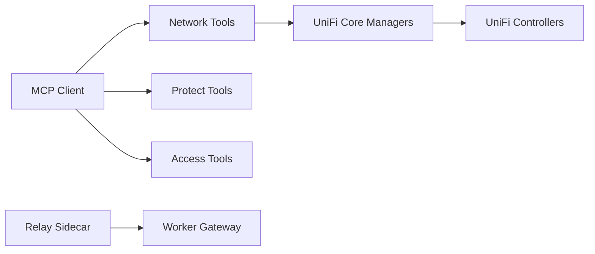

# sirkirby/unifi-mcp

> MCP servers to drive UniFi Network, Protect and Access controllers from an AI assistant.

## The problem
Administering a UniFi network, its cameras and its access control requires navigating several interfaces.

## What it actually does
Three MCP servers (194 Network tools, 62 Protect, 37 Access) talk to local controllers. Every change goes through a preview then a confirmation. Secrets are redacted by default. Option: a beta REST and GraphQL API server, and a cloud relay via a Cloudflare Worker. Lazy or full discovery modes.

## How it is wired


## Trying it
```bash
uvx unifi-network-mcp@latest
uvx unifi-protect-mcp@latest
uvx unifi-access-mcp@latest
```

## Cost and gotchas
Requires a local administrator account without MFA (no Ubiquiti SSO). The HTTP MCP is unauthenticated: trusted local use only. The cloud relay uses Cloudflare.

## What it is not
Not a tool for other brands. Giving an agent write access to your firewall means staying in confirmation mode.

## Alternatives
No alternative named in the README.

## For you
Ignore for data/AI work: only useful if you administer a UniFi fleet; otherwise irrelevant.
