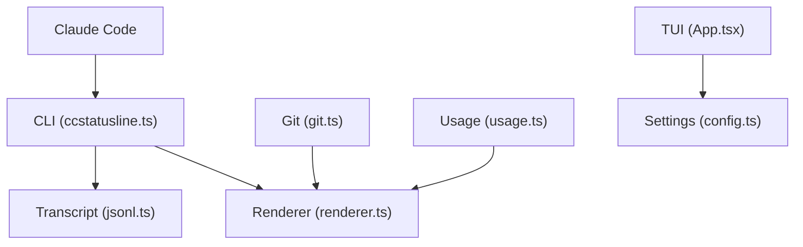

# sirmalloc/ccstatusline

> Configurable status line formatter for Claude Code, with model, git, token and usage widgets.

## The problem
Claude Code's default status line shows little information; tracking context, cache, usage limits and git means scripting it yourself.

## What it actually does
Claude Code sends its state to the CLI, which reads the transcript, queries git/JJ, the usage API and the service status, then displays the configured widgets. A TUI (Ink) lets you compose several lines, colors, Powerline themes, JSON import/export, and writes the command into Claude Code's settings.

## How it is wired


## Trying it
```bash
npx -y ccstatusline@latest
bunx -y ccstatusline@latest
```

## Cost and gotchas
Free. The usage widgets call an online API. Under `bunx`, `@latest` adds about 430 ms per refresh; the README recommends a pinned global install. The empty status in an untrusted folder is documented.

## What it is not
Does not modify Claude Code itself: it is a status line command. Not multi-agent. The README is truncated by a long version history.

## Alternatives
No alternative named in the README.

## For you
Adopt if you work with Claude Code daily: one-command install, free, and useful for monitoring context and quotas.
