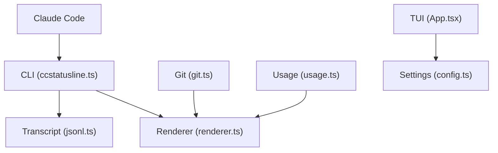

# sirmalloc/ccstatusline

> Formateur de ligne d'état configurable pour Claude Code, avec widgets modèle, git, tokens et usage.

## Le problème
La ligne d'état par défaut de Claude Code montre peu d'informations ; suivre le contexte, le cache, les limites d'usage et git demande de scripter soi-même.

## Ce que ça fait vraiment
Claude Code envoie son état à la CLI, qui lit la transcription, interroge git/JJ, l'API d'usage et le statut du service, puis affiche les widgets configurés. Une interface TUI (Ink) permet de composer plusieurs lignes, couleurs, thèmes Powerline, import/export JSON, et écrit la commande dans les paramètres de Claude Code.

## Comment c'est branché


## Essayer
```bash
npx -y ccstatusline@latest
bunx -y ccstatusline@latest
```

## Coût et pièges
Gratuit. Les widgets d'usage appellent une API en ligne. Sous `bunx`, `@latest` ajoute environ 430 ms par rafraîchissement ; le README conseille l'installation globale épinglée. Le statut vide dans un dossier non approuvé est documenté.

## Ce que ce n'est pas
Ne modifie pas Claude Code lui-même : c'est une commande de ligne d'état. Pas multi-agent. Le README est tronqué sur un long historique de versions.

## Alternatives
Aucune alternative nommée dans le README.

## Pour toi
À adopter si tu travailles quotidiennement avec Claude Code : installation en une commande, gratuit, et utile pour surveiller contexte et quotas.

