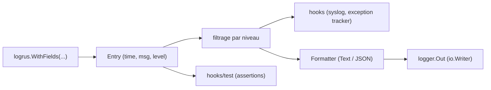

# sirupsen/logrus

> Structured logger for Go, compatible with the standard library logger.

## The problem
A concatenated `printf` message cannot be parsed: the useful values are buried in the sentence.
Migrating from a standard logger to a structured one usually breaks all existing calls.

## What it actually does
API identical to `log`: replacing the import is enough to get structured logging.
`WithFields` attaches key-value pairs; a reusable `Entry` carries common fields (request_id, user_ip).
Two built-in formatters — colored text on a TTY, logfmt otherwise, and JSON — plus third-party formatters (GELF, logstash, redactrus…).
Seven levels (Trace to Panic), per-level hooks (syslog, Airbrake), handlers run before `os.Exit(1)`, a test hook for assertions.

## How it is wired


## Trying it
```bash
go test -bench=ReportCaller
```

## Cost and gotchas
`SetReportCaller(true)` adds the method name but costs a measured 20 to 40% overhead.
The organization name is lowercased: import `github.com/sirupsen/logrus`, not the uppercase variant.

## What it is not
It is not an evolving project: it is in maintenance mode, security and bug fixes only, with no v2 planned.
It is not a rotation manager: rotation is delegated to `logrotate(8)` by design.
It is not environment-aware: telling dev from production is the application's job.

## Alternatives
rs/zerolog, uber-go/zap, apex/log: recommended by the author himself as modern successors.
Go `log/slog`: the direction of the ecosystem, interoperability with it being the only remaining planned change.

## For you
Ignore: the author himself points to zerolog, zap or `log/slog`.
