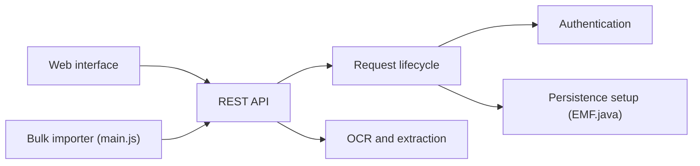

# sismics/docs

> Teedy: lightweight, self-hosted document management with OCR and full-text search.

## The problem
Filing, finding and sharing documents (PDF, Office, images) without a cloud service.

## What it actually does
Java application (WAR) with a web interface, REST API and Android client: OCR (Tesseract), full-text search, nested tags, Dublin Core metadata, file versions, 256-bit AES encryption, workflows, groups and permissions, 2FA, LDAP, webhooks, import of e-mails and folders. Claimed to be tested up to one million documents.

## How it is wired

Document processing is not visible in the architecture excerpts.

## Trying it
```bash
docker run -d -p 8080:8080 -v ./docs/data:/data -e DOCS_BASE_URL=https://docs.example.com sismics/docs:v1.11
```

## Cost and gotchas
Free. Default admin password "admin" must be changed. The embedded H2 database is for testing only: use PostgreSQL for production. The `latest` image tracks master and may be unstable.

## What it is not
Not an enterprise document-management tool with support: a community project under GPL-2.0.

## Alternatives
No alternative named in the README.

## For you
Worth watching: a supplementary document base with OCR if you want to self-host; no direct link with AI.
