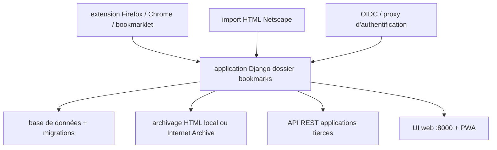

# sissbruecker/linkding

> Self-hosted, minimal and fast bookmark manager, installed through Docker.

## The problem
Browser bookmarks cannot be shared, cannot be annotated, and disappear with the profile.
Equivalent online services impose a third-party account and loss of control over the data.

## What it actually does
Organizes bookmarks by tags, with bulk editing, Markdown notes and a "read later" feature.
Automatically fetches the title, description and icon of pages, and archives sites as local HTML or on the Internet Archive.
Sharing between users or with guests; import/export in Netscape HTML format; installable as a PWA.
REST API for third-party applications, SSO via OIDC or authentication proxy, Django admin panel.

## How it is wired


## Trying it
```bash
make init
uv run manage.py createsuperuser --username=joe --email=joe@example.com
make frontend
make serve
make test
make lint
make format
```

## Cost and gotchas
Free; the cost is hosting the container. For development you need Python 3.13, uv and Node.js.
Pitfall: the README refers production installation to the external documentation linkding.link — the commands above are the development ones.

## What it is not
Not a content reader: archiving keeps the page, it does not turn it into a reading library.
Not a managed service, unless you go through one of the hosting options cited.
Not extensible on the server side: it is standard Django, to be modified yourself.

## Alternatives
- Community projects listed in the README (mobile apps, extensions, libraries): complements, not substitutes.

## For you
Good for archiving your watch with tags and notes, under your control; no direct relation to data.
