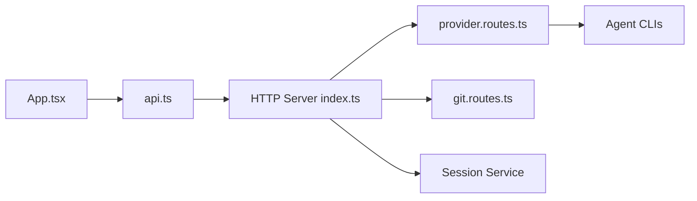

# siteboon/claudecodeui

> Web and mobile interface to drive Claude Code, Cursor CLI and Codex on your projects.

## The problem
CLI coding agents require an open terminal; hard to resume them from a phone or to see the whole history.

## What it actually does
Node server with a React client: chat, built-in terminal, file explorer, Git explorer, sessions automatically found in `~/.claude`. Reads and writes the Claude Code MCP config. Plugin system, optional TaskMaster, Electron desktop app, hosted cloud offering.

## How it is wired


## Trying it
```bash
npx @cloudcli-ai/cloudcli
npm install -g @cloudcli-ai/cloudcli
cloudcli
```
Then `http://localhost:3001`.

## Cost and gotchas
Node 22+. You need your own Claude, Cursor or Codex subscriptions. Cloud offering from €7/month. Modifies the local `~/.claude` config. Tools disabled by default.

## What it is not
Not an agent: it provides the environment, not the AI. The Docker Sandbox mode is experimental.

## Alternatives
- Claude Code Remote Control: compared in the FAQ; a single active session, machine must stay on.

## For you
Worth watching: useful if you let agents work remotely, but AGPL-3.0 and write access to your config; test in a sandbox.
