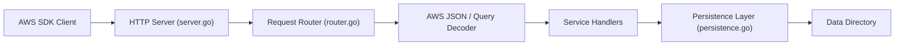

# sivchari/kumo

> Lightweight AWS emulator in a single binary, with no authentication, for testing in CI.

## The problem
Testing code that calls AWS (S3, SQS, DynamoDB) in CI costs money and requires credentials, or a heavy emulation stack.

## What it actually does
A local server on port 4566 that answers calls from the AWS Go v2 SDK, with 82 advertised services (S3, DynamoDB, SQS, SNS, Lambda, IAM, SageMaker, Glue, Athena, etc.). In-memory state by default, optional JSON persistence via `KUMO_DATA_DIR`. Two endpoints specific to kumo to read the SES emails and SMS messages sent. The number of services is the README's; the actual extent per service is not verified.

## How it is wired


## Trying it
```bash
docker run -p 4566:4566 ghcr.io/sivchari/kumo:latest
make build
./bin/kumo
KUMO_DATA_DIR=./data ./bin/kumo
```

## Cost and gotchas
Free. Without `KUMO_DATA_DIR`, everything is lost on shutdown; in-flight SQS messages and S3 multipart uploads are not persisted. 168 open issues for a repository created in February 2026.

## What it is not
Not AWS: behavior may differ from the real thing, and nothing guarantees fidelity for the less common services. Not a load or security tool.

## Alternatives
No alternative named in the README.

## For you
Worth watching: simulating S3, SQS or SageMaker in the tests of an MLOps pipeline without an AWS account is attractive, but the project is young and its fidelity remains to be verified.
