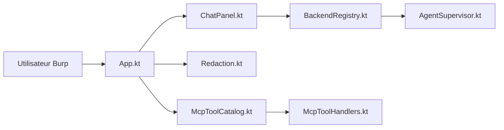

# six2dez/burp-ai-agent

> Burp Suite "Custom AI Agent" extension that plugs AI models into web traffic analysis, for penetration testers.

## The problem
Manually analyzing Burp's HTTP history and writing up findings is slow; connecting an AI assistant to Burp requires wiring and raises privacy questions.

## What it actually does
- Adds an AI chat tab in Burp: you send a request from the history to a model (12 backends: Ollama, LM Studio, Anthropic, Perplexity, Claude/Gemini/Codex CLIs…).
- Exposes Burp tools through an MCP server (8 in the BApp Store build, 59 in the full build) so a client like Claude Desktop can drive Burp.
- Provides passive and active AI scanners (62 vulnerability classes); scanners start disabled and queuing targets is confirmed by hand.
- Three privacy modes (STRICT / BALANCED / OFF) that mask cookies, tokens and hosts before sending; optional audit log; tool calls issued by the model require approval.

## How it is wired


## Trying it
```bash
git clone https://github.com/six2dez/burp-ai-agent.git
cd burp-ai-agent
JAVA_HOME=/path/to/jdk-21 ./gradlew clean fullJar
# ou, build BApp Store :
JAVA_HOME=/path/to/jdk-21 ./gradlew clean bappJar
```
Then in Burp: Extensions > Installed > Add > Java > choose the `.jar` (one build at a time).

## Cost and gotchas
Free extension (MIT); cloud models (Anthropic, NIM, Perplexity…) are billed to you, local models (Ollama, LM Studio) are not. Secrets are encrypted but the master key is stored alongside in Burp's preferences: mere obfuscation.

## What it is not
Neither an unsupervised autonomous scanner, nor a legal tool without authorization: the README states that targeting a system without consent is illegal. Versions ≤ 1.0.0 had flaws fixed in 1.1.0 (MCP token, cookie leak): update and rotate secrets. Not listed in the BApp Store to date (submission in progress).

## Alternatives
- Burp AI (built into Burp Suite): native provider, no third-party extension.

## For you
Worth watching: useful if you do authorized penetration testing with Burp and local LLMs, but a young project, carried by one person, that recently fixed critical flaws.
