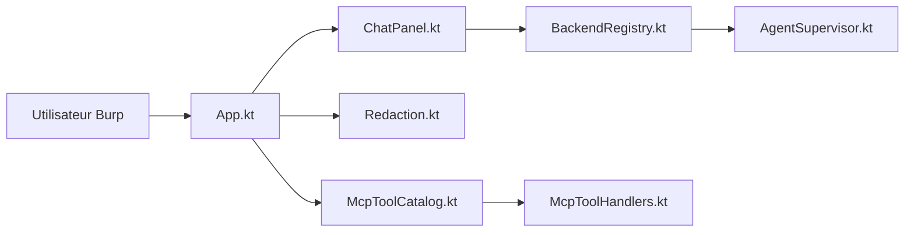

# six2dez/burp-ai-agent

> Extension Burp Suite « Custom AI Agent » qui branche des modèles d'IA sur l'analyse de trafic web, pour testeurs d'intrusion.

## Le problème
Analyser à la main l'historique HTTP de Burp et rédiger les constats est long ; relier un assistant IA à Burp demande du câblage et pose des questions de confidentialité.

## Ce que ça fait vraiment
- Ajoute un onglet de chat IA dans Burp : on envoie une requête de l'historique à un modèle (12 backends : Ollama, LM Studio, Anthropic, Perplexity, CLI Claude/Gemini/Codex…).
- Expose des outils Burp via un serveur MCP (8 dans la build BApp Store, 59 dans la build complète) pour qu'un client comme Claude Desktop pilote Burp.
- Fournit des scanners IA passif et actif (62 classes de vulnérabilités) ; les scanners démarrent désactivés et la mise en file des cibles se confirme à la main.
- Trois modes de confidentialité (STRICT / BALANCED / OFF) qui masquent cookies, jetons et hôtes avant envoi ; journal d'audit optionnel ; les appels d'outils émis par le modèle demandent une approbation.

## Comment c'est branché


## Essayer
```bash
git clone https://github.com/six2dez/burp-ai-agent.git
cd burp-ai-agent
JAVA_HOME=/path/to/jdk-21 ./gradlew clean fullJar
# ou, build BApp Store :
JAVA_HOME=/path/to/jdk-21 ./gradlew clean bappJar
```
Puis Burp : Extensions > Installed > Add > Java > choisir le `.jar` (une seule build à la fois).

## Coût et pièges
Extension gratuite (MIT) ; les modèles cloud (Anthropic, NIM, Perplexity…) sont facturés à ta charge, les modèles locaux (Ollama, LM Studio) non. Les secrets sont chiffrés mais la clé maître est stockée à côté dans les préférences Burp : simple obscurcissement.

## Ce que ce n'est pas
Ni un scanner autonome sans supervision, ni un outil légal sans autorisation : le README précise que cibler un système sans consentement est illégal. Les versions ≤ 1.0.0 ont eu des failles corrigées en 1.1.0 (jeton MCP, fuite de cookies) : mettre à jour et faire tourner les secrets. Non listée au BApp Store à ce jour (soumission en cours).

## Alternatives
- Burp AI (intégré à Burp Suite) : fournisseur natif, sans extension tierce.

## Pour toi
À surveiller : utile si tu fais du test d'intrusion autorisé avec Burp et des LLM locaux, mais projet jeune, porté par une seule personne, qui a corrigé des failles critiques récentes.

