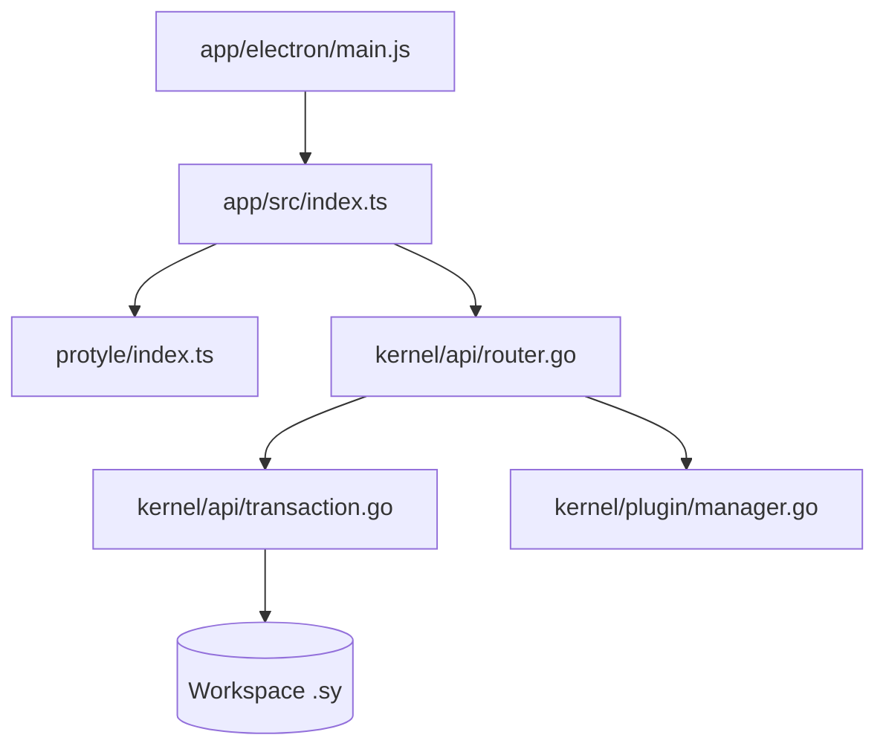

# siyuan-note/siyuan

> Personal knowledge management tool focused on privacy, with block-level referencing and Markdown WYSIWYG support.

## The problem
Flat-file notes do not allow for fine referencing between blocks or queries, and cloud services raise concerns about data privacy.

## What it actually does
Application desktop (Electron), Docker web service and direct CLI on the workspace. Go core (HTTP/WebSocket API, SQL index), Protyle editor in TypeScript, sandboxed plugins, AI chat via OpenAI API, MCP support, Pandoc export, Tesseract OCR, flashcards. Documents stored in JSON `.sy` format. Some features are reserved for paying members.

## How it is wired


## Trying it
```bash
docker run -d \
  -v /siyuan/workspace:/siyuan/workspace \
  -p 6806:6806 \
  b3log/siyuan \
  serve \
  --workspace=/siyuan/workspace/ \
  --accessAuthCode="${AuthCode:?Set AuthCode}"
```

## Cost and gotchas
Free for basic use, with a subscription required for certain features. When using Docker, a strong access code is essential. Only one writer per workspace. The AI chat requires an API key.

## What it is not
The Docker mode does not provide PDF/Word export, Markdown import, or connection for desktop and mobile applications. License: AGPL-3.0.

## Alternatives
No alternative is specified in the README file.

## For you
Suitable for a knowledge base with SQL queries, but AGPL and Docker are limited; consider it if Obsidian or Joplin are not sufficient for your needs.
