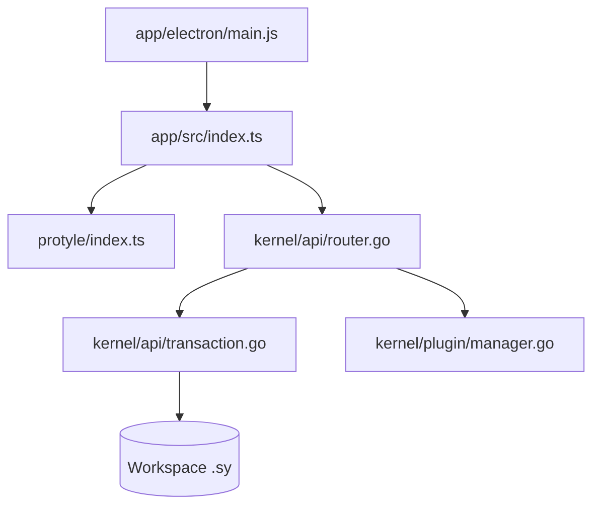

# siyuan-note/siyuan

> Gestionnaire de connaissances personnel axé vie privée, avec références au niveau du bloc et Markdown WYSIWYG.

## Le problème
Les notes en fichiers plats ne permettent ni références fines entre blocs ni requêtes, et les services cloud posent un souci de confidentialité.

## Ce que ça fait vraiment
Application bureau (Electron), service web Docker et CLI directe sur l'espace de travail. Noyau Go (API HTTP/WebSocket, index SQL), éditeur Protyle en TypeScript, plugins sandboxés, chat IA via API OpenAI, support MCP, export Pandoc, OCR Tesseract, flashcards. Documents stockés en JSON `.sy`. Certaines fonctions sont réservées aux membres payants.

## Comment c'est branché


## Essayer
```bash
docker run -d \
  -v /siyuan/workspace:/siyuan/workspace \
  -p 6806:6806 \
  b3log/siyuan \
  serve \
  --workspace=/siyuan/workspace/ \
  --accessAuthCode="${AuthCode:?Set AuthCode}"
```

## Coût et pièges
Gratuit pour l'essentiel, abonnement pour certaines fonctions. En Docker, un code d'accès fort est indispensable. Un seul écrivain par espace de travail. Le chat IA suppose une clé d'API.

## Ce que ce n'est pas
Le mode Docker ne fournit ni export PDF/Word, ni import Markdown, ni connexion des applications bureau et mobile. Licence AGPL-3.0.

## Alternatives
Aucune alternative nommée dans le README.

## Pour toi
Solide pour une base de connaissances avec requêtes SQL, mais AGPL et Docker limité ; surveille-le si Obsidian ou Joplin ne te suffisent pas.

