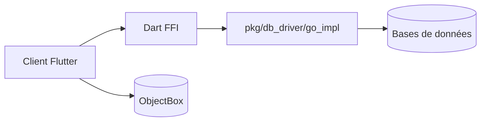

# sjjian/openhare

> Multi-database desktop SQL client with an AI assistant, for developers, analysts and DBAs.

## The problem
Switching from one client to another depending on the database (MySQL, PostgreSQL, ClickHouse, MongoDB) costs time.

## What it actually does
Native Flutter client, with no embedded browser, that connects to MySQL, PostgreSQL, SQL Server, SQLite, DuckDB, ClickHouse, Oracle, MongoDB and Redis. The drivers are written in Go and called through Dart FFI. An AI assistant helps write and optimize SQL, and asks for confirmation on risky queries.

## How it is wired
Simplified diagram based on the write-up, no diagram provided.

## Trying it
No command documented.

## Cost and gotchas
Free for the application. The assistant's model provider is not specified: any cost is undocumented. No installation procedure in the README.

## What it is not
Not a web client nor a server administration tool. MongoDB syntax aims at mongosh compatibility, with no full guarantee.

## Alternatives
Not documented in the README.

## For you
Worth watching: useful for exploring several databases including DuckDB and ClickHouse, but the README explains neither installation nor AI configuration.
