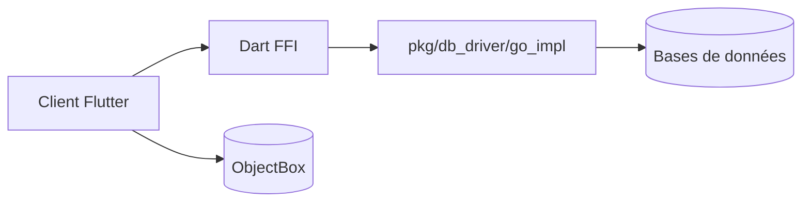

# sjjian/openhare

> Client SQL de bureau multi-bases avec assistant IA, pour développeurs, analystes et DBA.

## Le problème
Passer d'un client à l'autre selon la base (MySQL, PostgreSQL, ClickHouse, MongoDB) coûte du temps.

## Ce que ça fait vraiment
Client Flutter natif, sans navigateur embarqué, qui se connecte à MySQL, PostgreSQL, SQL Server, SQLite, DuckDB, ClickHouse, Oracle, MongoDB et Redis. Les pilotes sont écrits en Go et appelés par FFI Dart. Un assistant IA aide à écrire et optimiser le SQL, et demande confirmation pour les requêtes risquées.

## Comment c'est branché
Schéma simplifié d'après la fiche, sans diagramme fourni.

## Essayer
Aucune commande documentée.

## Coût et pièges
Gratuit pour l'application. Le fournisseur du modèle de l'assistant n'est pas précisé : le coût éventuel est non documenté. Pas de procédure d'installation dans le README.

## Ce que ce n'est pas
Ce n'est pas un client web ni un outil d'administration serveur. La syntaxe MongoDB vise la compatibilité mongosh, sans garantie complète.

## Alternatives
Non documenté dans le README.

## Pour toi
À surveiller : utile pour explorer plusieurs bases dont DuckDB et ClickHouse, mais le README n'explique ni l'installation ni la configuration de l'IA.

