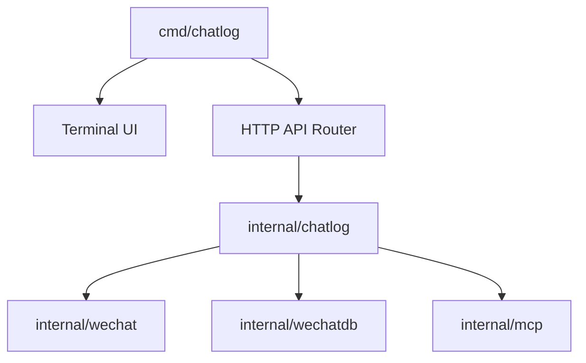

# sjzar/chatlog

> Go tool that exposed local WeChat conversation histories to AI assistants; withdrawn by its author.

## The problem
A messaging app's conversations stay locked in encrypted local databases. Exploiting them (search, AI assistants) requires access to them.

## What it actually does
The current README is a withdrawal notice dated October 20, 2025 (in Chinese). The author received a letter from WeChat judging the core feature risky for compliance, and deleted the code and history. They ask that local copies be deleted and advise against any use. According to the described architecture: a CLI with terminal interface, an HTTP API and an MCP SSE endpoint on top of WeChat data-access modules.

## How it is wired

## Trying it
No command documented: the repository now contains only the withdrawal notice.

## Cost and gotchas
Nothing to install or pay for, since the code can no longer be downloaded. A legal risk remains for anyone keeping old copies. No license.

## What it is not
It is no longer an available, maintained or supported project. What was read is a notice, not a tool's documentation; the technical details above come from the described architecture, not from the README.

## Alternatives
None named in the README.

## For you
Ignore: code withdrawn at the request of WeChat's publisher, no license, no support, and access to third-party messaging data raises a compliance problem.
