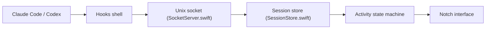

# sk-ruban/notchi

> macOS app that animates the MacBook notch according to Claude Code and Codex activity.

## The problem
Following what coding agents do in the background forces you to keep the terminal visible.

## What it actually does
Installs shell hooks in Claude Code and Codex that send events through a Unix socket. The app parses them, runs them through a state machine and animates mascots. Optional: sentiment analysis of prompts via the Anthropic or OpenAI API, cost and token tracking over 30 days.

## How it is wired


## Trying it
```bash
# Pas de commande : télécharger le DMG depuis les releases, le glisser dans Applications, le lancer
```

## Cost and gotchas
Free. macOS 15+, MacBook with a notch. Sentiment analysis sends your prompts to Anthropic or OpenAI with your key (billed by them). A keychain window asks for access for the stats.

## What it is not
Not a serious monitoring tool: it is a playful companion. Does not work outside macOS.

## Alternatives
No alternative named; the README cites Claude Island as an inspiration.

## For you
Ignore: a macOS gimmick with no value for a data/AI pipeline; GPL-3.0 and a single maintainer on top of that.
