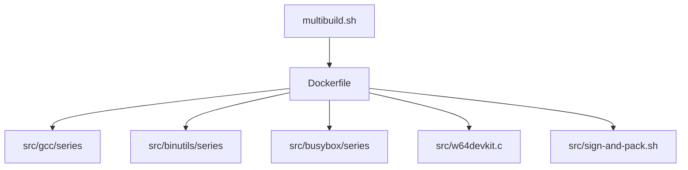

# skeeto/w64devkit

> Portable C, C++ and Fortran compiler toolchain for Windows, with no installation, built by a Dockerfile.

## The problem
Getting a full GCC compiler on Windows, with a debugger and Unix tools, requires a heavy installation.

## What it actually does
The Dockerfile builds from source GCC (Mingw-w64), binutils, GDB, Make, CMake, Ninja, busybox, Vim, ccache and NSIS, with per-tool patches, then produces a self-extracting 7z archive. The whole is static and offline, with a few in-house tools (`peports`, `nroff`, `libmemory`).

## How it is wired


## Trying it
```bash
docker build -t w64devkit .
docker run --rm w64devkit >w64devkit-x64.exe
set PATH=c:\path\to\w64devkit\bin;%PATH%
```

## Cost and gotchas
Free (Unlicense). Using the kit does not require Docker; building it does: about 15 minutes and network access at the start. Do not use PowerShell for the redirection. No ASan or TSan.

## What it is not
Not an environment for Python or data science. MSVCRT toolchain, not compatible with all MSVC code.

## Alternatives
- LLVM MinGW: same goals, but with LLVM.

## For you
Ignore: useful for compiling C on Windows, unrelated to your daily data, AI or MLOps work.
