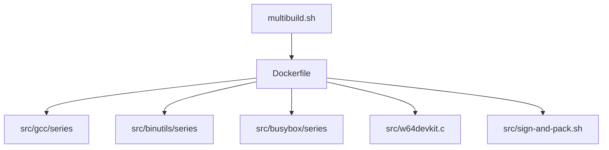

# skeeto/w64devkit

> Chaîne de compilation C, C++ et Fortran portable pour Windows, sans installation, construite par Dockerfile.

## Le problème
Obtenir sous Windows un compilateur GCC complet, avec débogueur et outils Unix, demande une installation lourde.

## Ce que ça fait vraiment
Le Dockerfile compile depuis les sources GCC (Mingw-w64), binutils, GDB, Make, CMake, Ninja, busybox, Vim, ccache et NSIS, avec des correctifs par outil, puis produit une archive 7z auto-extractible. L'ensemble est statique, hors ligne, avec quelques outils maison (`peports`, `nroff`, `libmemory`).

## Comment c'est branché


## Essayer
```bash
docker build -t w64devkit .
docker run --rm w64devkit >w64devkit-x64.exe
set PATH=c:\path\to\w64devkit\bin;%PATH%
```

## Coût et pièges
Gratuit (Unlicense). Utiliser le kit ne demande pas Docker ; le construire, si : environ 15 minutes et un accès réseau au début. Ne pas utiliser PowerShell pour la redirection. Pas d'ASan ni de TSan.

## Ce que ce n'est pas
Pas un environnement pour Python ou data science. Chaîne MSVCRT, non compatible avec tout code MSVC.

## Alternatives
- LLVM MinGW : mêmes objectifs, mais avec LLVM.

## Pour toi
À ignorer : utile pour compiler du C sous Windows, sans rapport avec ton quotidien data, IA ou MLOps.

