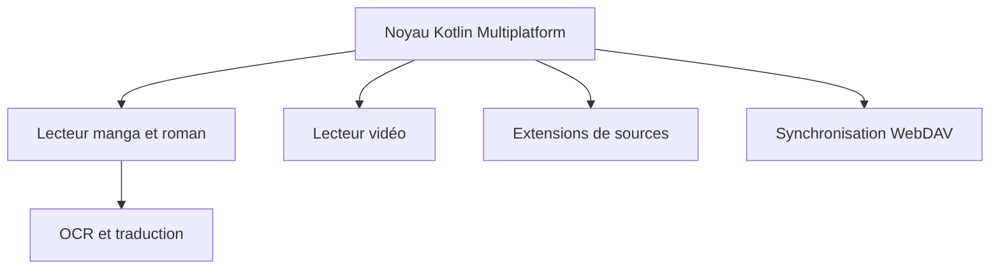

# skepsun/Kototoro

> Android reader for manga, novels and videos with OCR, local translation and WebDAV sync.

## The problem
Reading manga, novels and videos requires several apps with separate sources and progress.

## What it actually does
A single Jetpack Compose reader with in-reader OCR and translation, video super-resolution, DLNA casting, reading tracking and import of CBZ, EPUB, MKV files. It loads third-party extensions (Mihon, Aniyomi, Legado, TVBox, Cloudstream). Windows and iOS exist in preview.

## How it is wired
Simplified diagram based on the sheet, no diagram provided.

## Trying it
No command in the README: install the APK from Releases, then follow the wizard on first launch.

## Cost and gotchas
Free. The repository ships no content source: you add third-party extension repositories yourself, at your own responsibility.

## What it is not
Not a content provider. On Windows and iOS, sync and OCR are not yet available.

## Alternatives
Kotatsu, from which it originates but is no longer a fork.

## For you
Ignore: entertainment reader, unrelated to data, AI or MLOps work.
