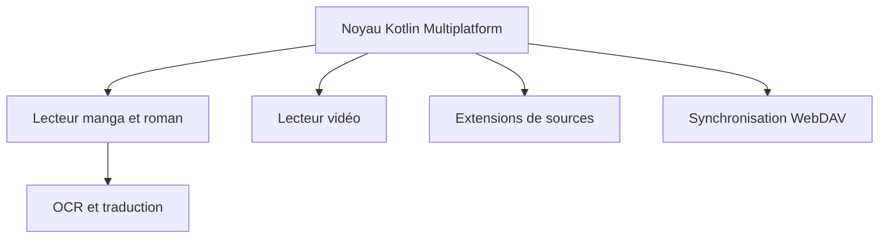

# skepsun/Kototoro

> Lecteur Android de mangas, romans et vidéos avec OCR, traduction locale et synchronisation WebDAV.

## Le problème
Lire mangas, romans et vidéos exige plusieurs applications aux sources et progressions séparées.

## Ce que ça fait vraiment
Un seul lecteur en Jetpack Compose avec OCR et traduction dans le lecteur, super-résolution vidéo, projection DLNA, suivi de lecture et import de fichiers CBZ, EPUB, MKV. Il charge des extensions tierces (Mihon, Aniyomi, Legado, TVBox, Cloudstream). Windows et iOS existent en préversion.

## Comment c'est branché
Schéma simplifié d'après la fiche, sans diagramme fourni.

## Essayer
Aucune commande dans le README : installer l'APK depuis les Releases, puis suivre l'assistant au premier lancement.

## Coût et pièges
Gratuit. Le dépôt ne livre aucune source de contenu : tu ajoutes toi-même des dépôts d'extensions tierces, sous ta responsabilité.

## Ce que ce n'est pas
Pas un fournisseur de contenu. Sur Windows et iOS, synchronisation et OCR ne sont pas encore disponibles.

## Alternatives
Kotatsu, dont il est issu mais n'est plus un fork.

## Pour toi
À ignorer : lecteur de divertissement, sans rapport avec un travail data, IA ou MLOps.

