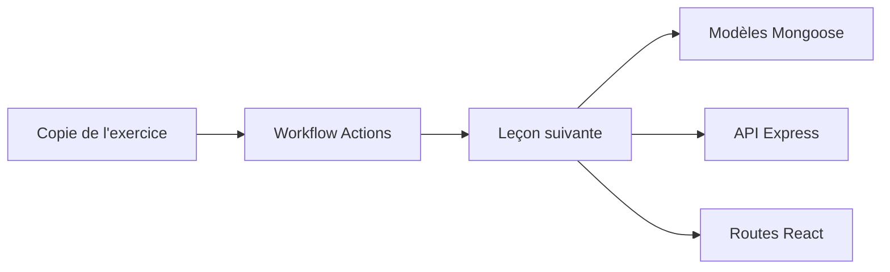

# skills/build-applications-w-copilot-agent-mode

> GitHub Skills exercise: build a React, Express and MongoDB application with Copilot's agent mode.

## The problem
Learn to frame a code assistant (tests first, architecture boundaries, review) rather than delegating to it without control.

## What it actually does
A guided course of 90 to 120 minutes that runs in a copied repository. You implement Mongoose models, an Express API and React routes for the OctoFit Tracker application, with failing tests as the contract, then a pull request review.

## How it is wired

## Trying it
No command: copy the exercise into your account, wait about twenty seconds, refresh the page.

## Cost and gotchas
Codespaces and GitHub Copilot are required (access not detailed). A public repository is recommended to avoid consuming Actions minutes; rerun the job once if it fails.

## What it is not
Not a tool or a library: a learning path centered on web development.

## Alternatives
No alternative named in the README.

## For you
Worth watching: useful for learning to frame a code agent with tests, even if the web stack is not yours.
