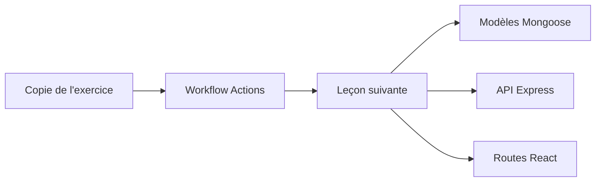

# skills/build-applications-w-copilot-agent-mode

> Exercice GitHub Skills : construire une application React, Express et MongoDB avec le mode agent de Copilot.

## Le problème
Apprendre à encadrer un assistant de code (tests d'abord, frontières d'architecture, revue) plutôt que de lui déléguer sans contrôle.

## Ce que ça fait vraiment
Cours guidé de 90 à 120 minutes qui s'exécute dans un dépôt copié. On y implémente des modèles Mongoose, une API Express et des routes React pour l'application OctoFit Tracker, avec des tests en échec comme contrat, puis une revue de pull request.

## Comment c'est branché

## Essayer
Aucune commande : copier l'exercice dans ton compte, attendre une vingtaine de secondes, rafraîchir la page.

## Coût et pièges
Il faut Codespaces et GitHub Copilot (accès non détaillé). Dépôt public conseillé pour éviter de consommer des minutes Actions ; relancer le job une fois en cas d'échec.

## Ce que ce n'est pas
Pas un outil ni une bibliothèque : un parcours d'apprentissage centré sur le développement web.

## Alternatives
Aucune alternative nommée dans le README.

## Pour toi
À surveiller : utile pour apprendre à cadrer un agent de code par des tests, même si la pile web n'est pas la tienne.

