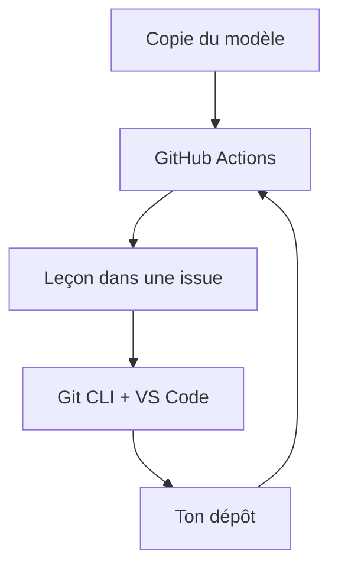

# skills/introduction-to-git

> Guided GitHub Skills exercise for beginners: learn Git on the command line and in VS Code.

## The problem
Learning Git without practice stays abstract. The exercise has you create a repository, commits and branches, in under an hour.

## What it actually does
- You copy the exercise into your GitHub account; an automation prepares the first lesson in about 20 seconds.
- Path: Git identity, first repository and commits, history and diffs, branches, collaboration basics.
- Common thread: developing small functions on a game.
- No prior experience required.

## How it is wired
Simplified diagram based on the sheet, no diagram provided.

## Trying it
No command documented: use the template copy button on the repository page, then refresh after about 20 seconds.

## Cost and gotchas
Free with a public repository (private repositories consume Actions minutes). A GitHub account is required. If nothing starts, check the Actions tab.

## What it is not
Not an advanced course: no rebase or detailed team workflows in the README. An exercise to do once, not a reference.

## Alternatives
No alternative cited in the README.

## For you
Ignore: you probably already master Git; keep it only to train a beginner on the team.
