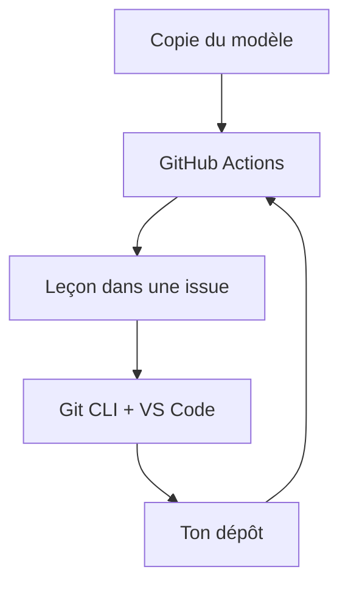

# skills/introduction-to-git

> Exercice guidé GitHub Skills pour débutants : apprendre Git en ligne de commande et dans VS Code.

## Le problème
Apprendre Git sans pratique reste abstrait. L'exercice fait créer un dépôt, des commits et des branches, en moins d'une heure.

## Ce que ça fait vraiment
- Tu copies l'exercice dans ton compte GitHub ; une automatisation prépare la première leçon en environ 20 secondes.
- Parcours : identité Git, premier dépôt et commits, historique et diffs, branches, notions de collaboration.
- Fil conducteur : développer de petites fonctions sur un jeu.
- Aucune expérience préalable requise.

## Comment c'est branché
Schéma simplifié d'après la fiche, sans diagramme fourni.

## Essayer
Aucune commande documentée : utiliser le bouton de copie du modèle sur la page du dépôt, puis rafraîchir après environ 20 secondes.

## Coût et pièges
Gratuit avec un dépôt public (les dépôts privés consomment des minutes Actions). Il faut un compte GitHub. Si rien ne se lance, vérifier l'onglet Actions.

## Ce que ce n'est pas
Pas un cours avancé : pas de rebase ni de flux d'équipe détaillés dans le README. Un exercice à faire une fois, pas une référence.

## Alternatives
Aucune alternative citée dans le README.

## Pour toi
À ignorer : tu maîtrises sans doute Git ; garde-le seulement pour former un débutant de l'équipe.

