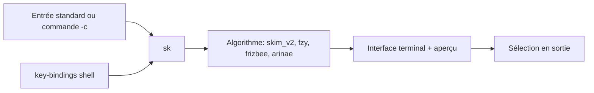

# skim-rs/skim

> A command-line fuzzy finder written in Rust, for those who browse files and history in the terminal.

## The problem
Finding a file, a line or a past command means chaining `find`, `grep` and hard-to-read pipes.

## What it actually does
An executable `sk` filters a list (standard input or a command's output) with fuzzy search. It offers an interactive mode hooked to `rg`, `ag` or `grep`, a preview window, shell key bindings (Ctrl-T, Ctrl-R, Alt-C) and a query syntax borrowed from fzf. It can also be used as a Rust library.

## How it is wired
Simplified diagram based on the sheet, no diagram provided.


## Trying it
```bash
brew install sk
vim $(find . -name "*.rs" | sk -m)
sk --ansi -i -c 'rg --color=always --line-number {q}'
source <(sk --shell bash)
```

## Cost and gotchas
Free, no account. By default it calls `find .`: set `SKIM_DEFAULT_COMMAND` to respect `.gitignore`. Display problems are possible on nix, FreeBSD or termux (TERMINFO variable).

## What it is not
Not an exact fzf clone: the options differ. The interactive `{q}` mode searches for the exact string, not fuzzy. No indexing engine: it filters what it is sent.

## Alternatives
- fzf (Go): the reference, larger ecosystem.
- fzf-lua: for Neovim, with a skim profile.

## For you
Adopt: a lightweight terminal tool that speeds up everyday exploration of repositories, logs and MLOps scripts.
