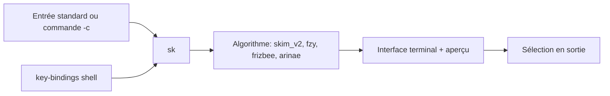

# skim-rs/skim

> Un sélecteur flou en ligne de commande écrit en Rust, pour qui navigue fichiers et historique au terminal.

## Le problème
Retrouver un fichier, une ligne ou une commande passée oblige à enchaîner `find`, `grep` et des pipes peu lisibles.

## Ce que ça fait vraiment
Un exécutable `sk` filtre une liste (entrée standard ou sortie d'une commande) avec une recherche floue. Il offre un mode interactif branché sur `rg`, `ag` ou `grep`, une fenêtre d'aperçu, des raccourcis shell (Ctrl-T, Ctrl-R, Alt-C) et une syntaxe de requête empruntée à fzf. Il s'utilise aussi comme bibliothèque Rust.

## Comment c'est branché
Schéma simplifié d'après la fiche, sans diagramme fourni.


## Essayer
```bash
brew install sk
vim $(find . -name "*.rs" | sk -m)
sk --ansi -i -c 'rg --color=always --line-number {q}'
source <(sk --shell bash)
```

## Coût et pièges
Gratuit, aucun compte. Par défaut il appelle `find .` : définir `SKIM_DEFAULT_COMMAND` pour respecter `.gitignore`. Problèmes d'affichage possibles sous nix, FreeBSD ou termux (variable TERMINFO).

## Ce que ce n'est pas
Pas un clone exact de fzf : les options diffèrent. Le mode interactif `{q}` cherche la chaîne exacte, pas floue. Pas de moteur d'indexation : il filtre ce qu'on lui envoie.

## Alternatives
- fzf (Go) : référence, écosystème plus large.
- fzf-lua : pour Neovim, avec profil skim.

## Pour toi
À adopter : un outil de terminal léger qui accélère l'exploration de dépôts, de logs et de scripts MLOps au quotidien.

