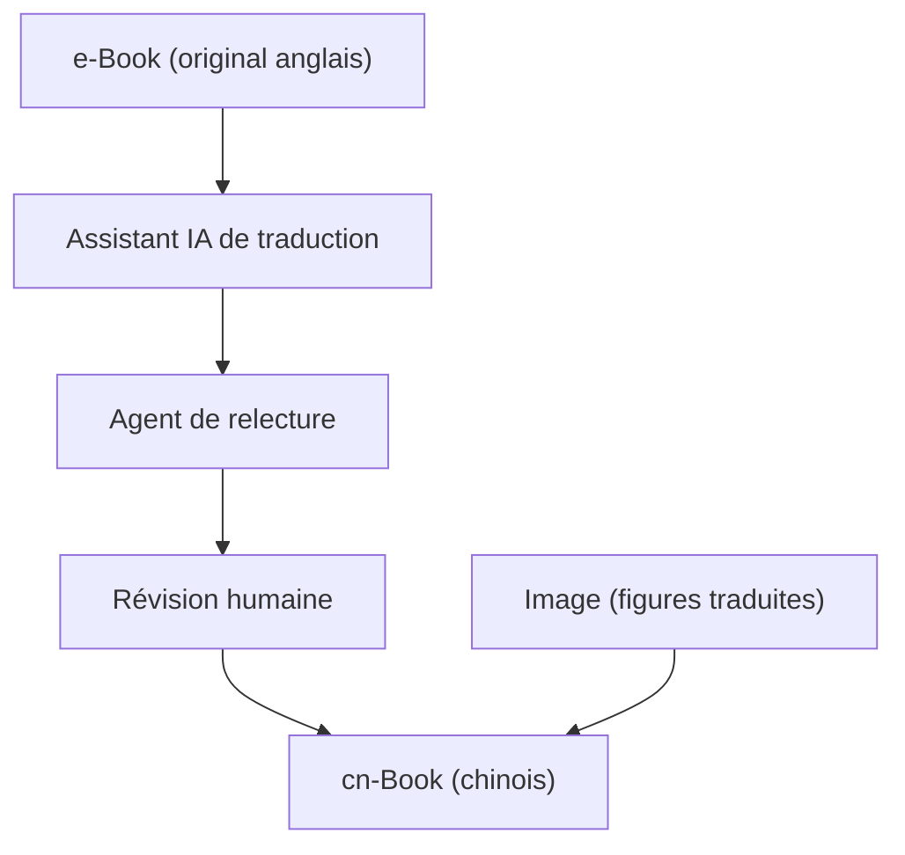

# skindhu/Build-A-Large-Language-Model-CN

> Chinese translation of the book "Build a Large Language Model (From Scratch)", for Chinese-speaking readers.

## The problem
The reference book for coding an LLM from scratch is in English, which holds back Chinese readers.

## What it actually does
The repository contains the original English book (e-Book), the Chinese version by chapter (cn-Book) and the translated images (Image). The translation follows three steps: a draft by an AI assistant, a review by a second agent, then a human revision. The author adds their own explanations. The chapters cover text, attention, GPT, pretraining, fine-tuning, instructions, PyTorch and LoRA. The README also includes personal reflections and links to articles.

## How it is wired
Simplified diagram based on the sheet, no diagram provided.

## Trying it
No command documented in the README, apart from a change to the hosts file to reach raw.githubusercontent.com.

## Cost and gotchas
Free. You need to read Chinese. The repository does not provide the book's code: it points to the official repository.

## What it is not
It is not an independent course: it is the translation of a copyrighted book, whose license is not identified by GitHub. The README mixes opinions and advertising on the author's behalf.

## Alternatives
No alternative named in the README.

## For you
Keep an eye on it: useful if you read Chinese or train colleagues; otherwise read the English original directly, which the repository also provides.
