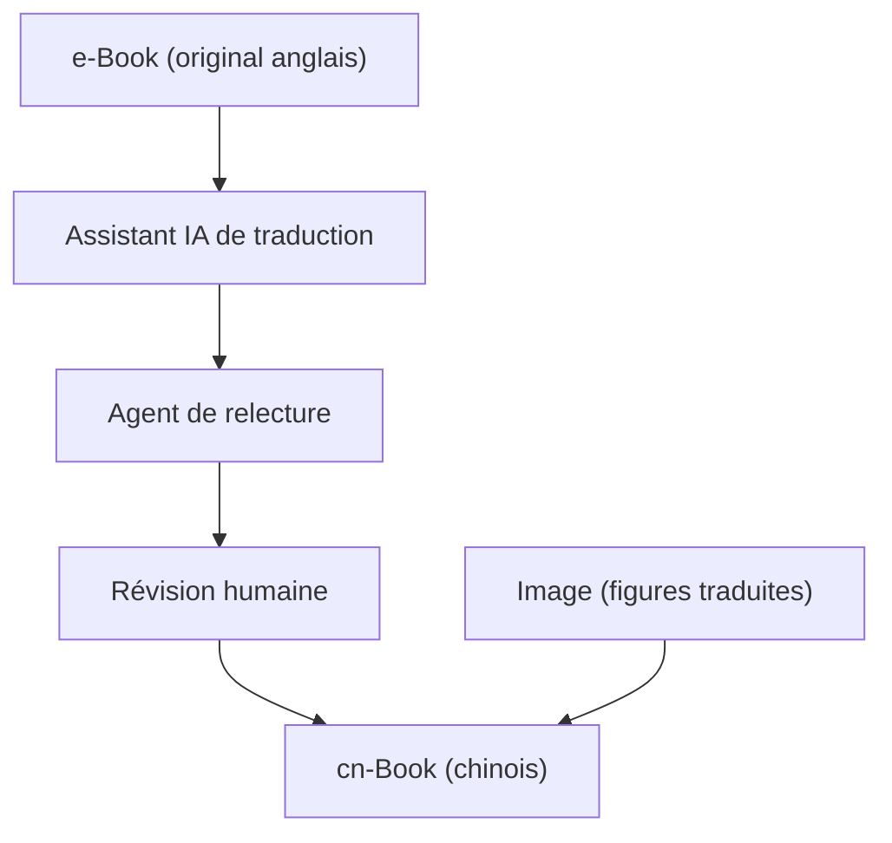

# skindhu/Build-A-Large-Language-Model-CN

> Traduction chinoise du livre « Build a Large Language Model (From Scratch) », pour lecteurs sinophones.

## Le problème
Le livre de référence pour coder un LLM de zéro est en anglais, ce qui freine les lecteurs chinois.

## Ce que ça fait vraiment
Le dépôt contient le livre original en anglais (e-Book), la version chinoise par chapitres (cn-Book) et les images traduites (Image). La traduction suit trois étapes : brouillon par un assistant IA, relecture par un second agent, puis révision humaine. L'auteur ajoute ses propres explications. Les chapitres couvrent texte, attention, GPT, préentraînement, fine-tuning, instructions, PyTorch et LoRA. Le README comporte aussi des réflexions personnelles et des liens vers des articles.

## Comment c'est branché
Schéma simplifié d'après la fiche, sans diagramme fourni.

## Essayer
Aucune commande documentée dans le README, hors une modification du fichier hosts pour accéder à raw.githubusercontent.com.

## Coût et pièges
Gratuit. Il faut lire le chinois. Le dépôt n'apporte pas le code du livre : il renvoie au dépôt officiel.

## Ce que ce n'est pas
Ce n'est pas un cours indépendant : c'est la traduction d'un livre sous droits, dont la licence n'est pas identifiée par GitHub. Le README mêle opinions et publicité pour le compte de l'auteur.

## Alternatives
Aucune alternative nommée dans le README.

## Pour toi
Surveiller : utile si tu lis le chinois ou forme des collègues, sinon lis directement l'original anglais, que le dépôt fournit aussi.

