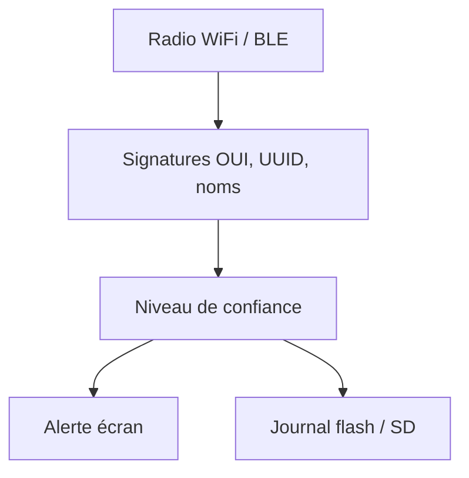

# skizzophrenic/SquachWatch-CYD

> ESP32 firmware that detects Flock cameras, AirTags, drones and skimmers over WiFi and Bluetooth.

## The problem
Knowing whether a surveillance or tracking device is within range without a PC or expensive hardware.

## What it actually does
On an ESP32 "Cheap Yellow Display" board (about 15 dollars), it listens to WiFi and Bluetooth and compares against signatures (OUI prefixes, UUIDs, names). Each signature has a confidence level (33 high, 4 medium, 60 low). Full-screen alerts, log in flash and on SD, filters, desk mode, presence detection via WiFi.

## How it is wired
Simplified diagram based on the sheet, no diagram provided.


## Trying it
```bash
git clone https://github.com/skizzophrenic/SquachWatch-CYD
cd SquachWatch-CYD
pio run -t upload
```

## Cost and gotchas
You need a compatible ESP32 board (web flasher at squachwatch.com); PlatformIO to compile. Hardware is at your expense. Many signatures are low confidence: false alerts are to be expected.

## What it is not
Not an offensive tool: it detects, it does not attack. Not a certain detector, most matches are hints shared with other devices.

## Alternatives
No alternative named in the README as read (the text is truncated).

## For you
Ignore: hardware and privacy tinkering project, outside the data/AI/MLOps scope, except for personal curiosity.
