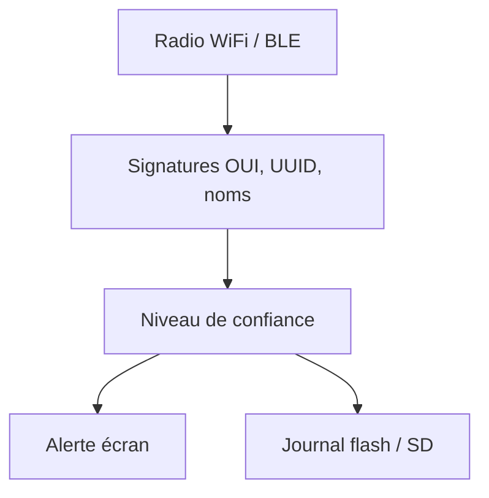

# skizzophrenic/SquachWatch-CYD

> Firmware ESP32 qui détecte par WiFi et Bluetooth caméras Flock, AirTags, drones et skimmers.

## Le problème
Savoir si un appareil de surveillance ou de pistage est à portée sans PC ni matériel coûteux.

## Ce que ça fait vraiment
Sur une carte ESP32 « Cheap Yellow Display » (environ 15 dollars), il écoute le WiFi et le Bluetooth et compare avec des signatures (préfixes OUI, UUID, noms). Chaque signature a un niveau de confiance (33 hautes, 4 moyennes, 60 basses). Alertes plein écran, journal en flash et sur SD, filtres, mode bureau, détection de présence par WiFi.

## Comment c'est branché
Schéma simplifié d'après la fiche, sans diagramme fourni.


## Essayer
```bash
git clone https://github.com/skizzophrenic/SquachWatch-CYD
cd SquachWatch-CYD
pio run -t upload
```

## Coût et pièges
Il faut une carte ESP32 compatible (flasheur web sur squachwatch.com) ; PlatformIO pour compiler. Le matériel est à ta charge. Beaucoup de signatures sont de confiance basse : de fausses alertes sont attendues.

## Ce que ce n'est pas
Pas un outil offensif : il détecte, il n'attaque pas. Pas un détecteur certain, la plupart des correspondances sont des indices partagés avec d'autres appareils.

## Alternatives
Aucune alternative nommée dans le README lu (le texte est tronqué).

## Pour toi
À ignorer : projet de bricolage matériel et vie privée, hors du périmètre data/IA/MLOps, sauf curiosité personnelle.

