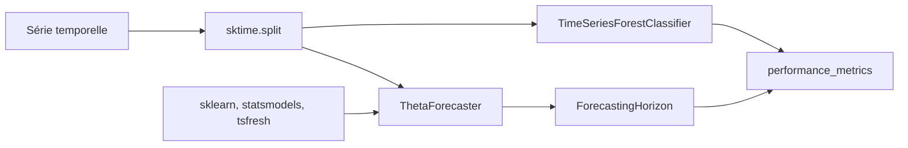

# sktime/sktime

> Unified scikit-learn-style interface for all time series learning tasks.

## The problem
Forecasting, classification, clustering and change-point detection on time series live in separate libraries with incompatible APIs, which can be neither composed nor compared cleanly.

## What it actually does
A single API covers forecasting, classification, regression, transformations (stable), detection, parameter estimation, clustering, distances/kernels, temporal splitting (maturing), alignment and distributions (experimental). Provides composition building blocks — pipelines, ensembles, tuning, reduction — making it possible to apply a scikit-learn regressor to a forecasting task. Interfaces to scikit-learn, statsmodels, tsfresh, PyOD, fbprophet. Version 1.1.0, Python 3.10 to 3.14, 64-bit.

## How it is wired


## Trying it
```bash
pip install sktime
pip install sktime[all_extras]
pip install sktime[forecasting,transformations]
conda install -c conda-forge sktime
```

## Cost and gotchas
Free, license shown in the repository. Heavy dependencies are not installed by default: you must choose a set of extras, and the README warns that even an extra only installs a chosen selection. Via conda, this fine-grained choice does not exist: it is all or nothing.

## What it is not
Not a temporal deep learning library: the advanced modules (alignment, distributions) are explicitly experimental, others only "maturing". Not a turnkey production tool: it is a layer of estimators, not a service.

## Alternatives
- **statsmodels**: raw statistical models, without a unified interface or composition.
- **tsfresh**: feature extraction only.
- **PyOD**: anomaly detection, outside a unified time series framework.

## For you
The reference for honestly comparing several forecasting approaches without rewriting the harness.
