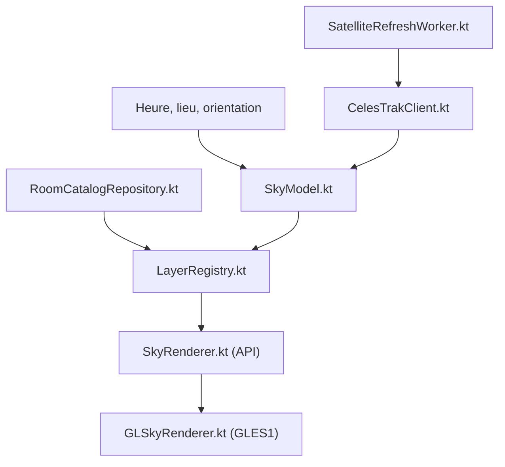

# sky-map-team/stardroid

> Android astronomy app, formerly Google Sky Map, rewritten in Kotlin in version 2.

## The problem
Identifying objects in the sky by pointing your phone, without an app cluttered with ads.

## What it actually does
v2 (Kotlin, Compose) computes sky positions, ephemerides and satellite passes from the time, location and sensors. A Room catalog feeds layers, rendered by an OpenGL ES 1 engine. Satellite TLEs come from CelesTrak. v1 is retired.

## How it is wired


## Trying it
```bash
# Aucune commande documentée dans le README.
```

## Cost and gotchas
Free, Android only. The GMS variant embeds Firebase Analytics; the F-Droid variant does not. Brand and icons are reserved to Penterakt LLC: a published fork must be renamed. License not identified by GitHub.

## What it is not
Not desktop astronomy software nor image processing: a mobile planetarium.

## Alternatives
No alternative named in the README.

## For you
Ignore: consumer app unrelated to data, AI or MLOps.
