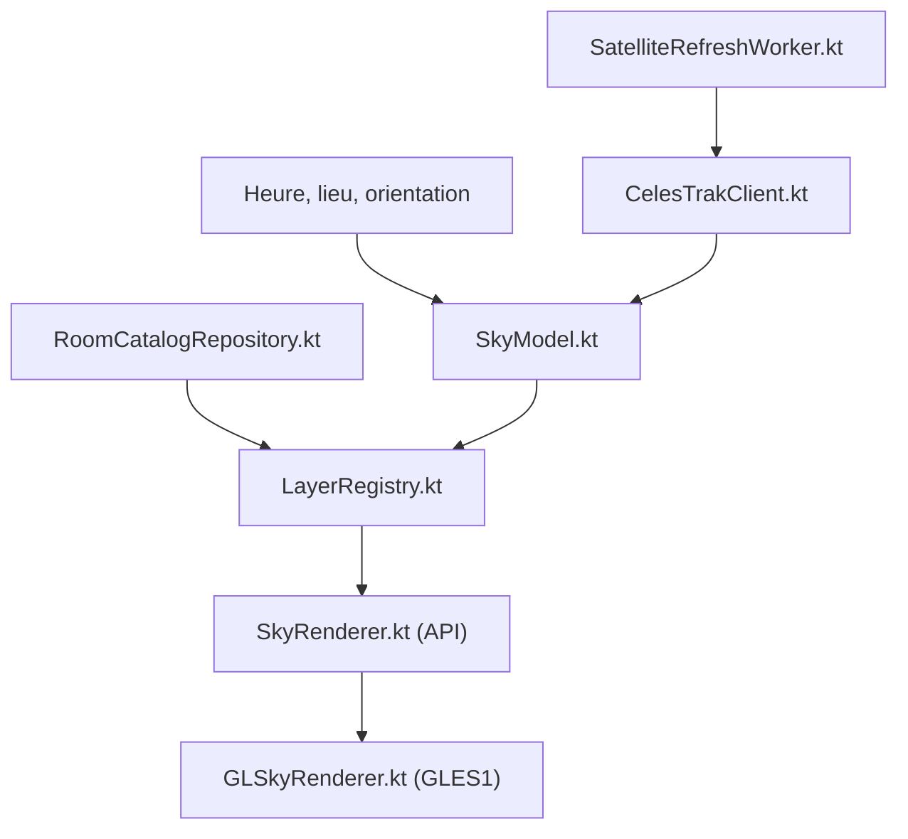

# sky-map-team/stardroid

> Application Android d'astronomie, ancienne Google Sky Map, réécrite en Kotlin dans sa version 2.

## Le problème
Identifier les objets du ciel en pointant son téléphone, sans application encombrée de publicités.

## Ce que ça fait vraiment
La v2 (Kotlin, Compose) calcule positions du ciel, éphémérides et passages de satellites à partir de l'heure, du lieu et des capteurs. Un catalogue Room alimente des couches, rendues par un moteur OpenGL ES 1. Les TLE des satellites viennent de CelesTrak. La v1 est retirée.

## Comment c'est branché


## Essayer
```bash
# Aucune commande documentée dans le README.
```

## Coût et pièges
Gratuit, Android seulement. La variante GMS embarque Firebase Analytics ; la variante F-Droid n'en a pas. Marque et icônes sont réservées à Penterakt LLC : un fork publié doit être renommé. Licence non identifiée par GitHub.

## Ce que ce n'est pas
Pas un logiciel d'astronomie de bureau ni de traitement d'images : un planétarium mobile.

## Alternatives
Aucune alternative nommée dans le README.

## Pour toi
À ignorer : application grand public sans lien avec la data, l'IA ou le MLOps.

