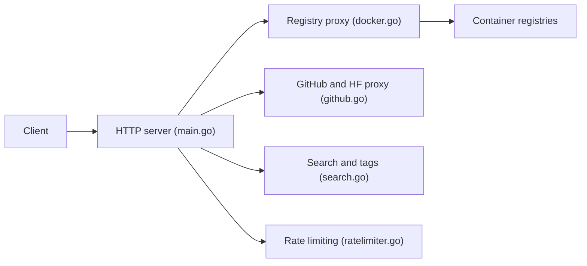

# sky22333/hubproxy

> Self-hosted Go proxy that speeds up Docker, GitHub and Hugging Face, for slow or filtered networks.

## The problem
Pulling images, cloning repositories or downloading models from slow or restricted networks is painful.

## What it actually does
A Go binary serves as a Registry API v2 compatible proxy (Docker Hub, GHCR, Quay, GCR, registry.k8s.io), as a relay for GitHub releases, raw and git clone (with URL rewriting in `.sh`/`.ps1` scripts) and for Hugging Face files. It adds per-IP rate limiting, blacklists/whitelists, an outbound SOCKS5 proxy and a Vue interface to search images and download archives offline.

## How it is wired


## Trying it
```bash
docker run -d --name hubproxy -p 5000:5000 --restart always ghcr.io/sky22333/hubproxy
curl http://127.0.0.1:5000/ready
docker pull yourdomain.com/nginx
```

## Cost and gotchas
Free; bandwidth is on you. The README advises against exposing a bare `http://IP:5000`: plan for a domain, HTTPS and a reverse proxy.

## What it is not
Not a registry: it relays, it does not store your images. An open proxy can be abused: configure limits and access lists.

## Alternatives
No alternative named in the README.

## For you
Worth watching: useful if you often download images and models from a constrained network, provided you secure it behind HTTPS.
